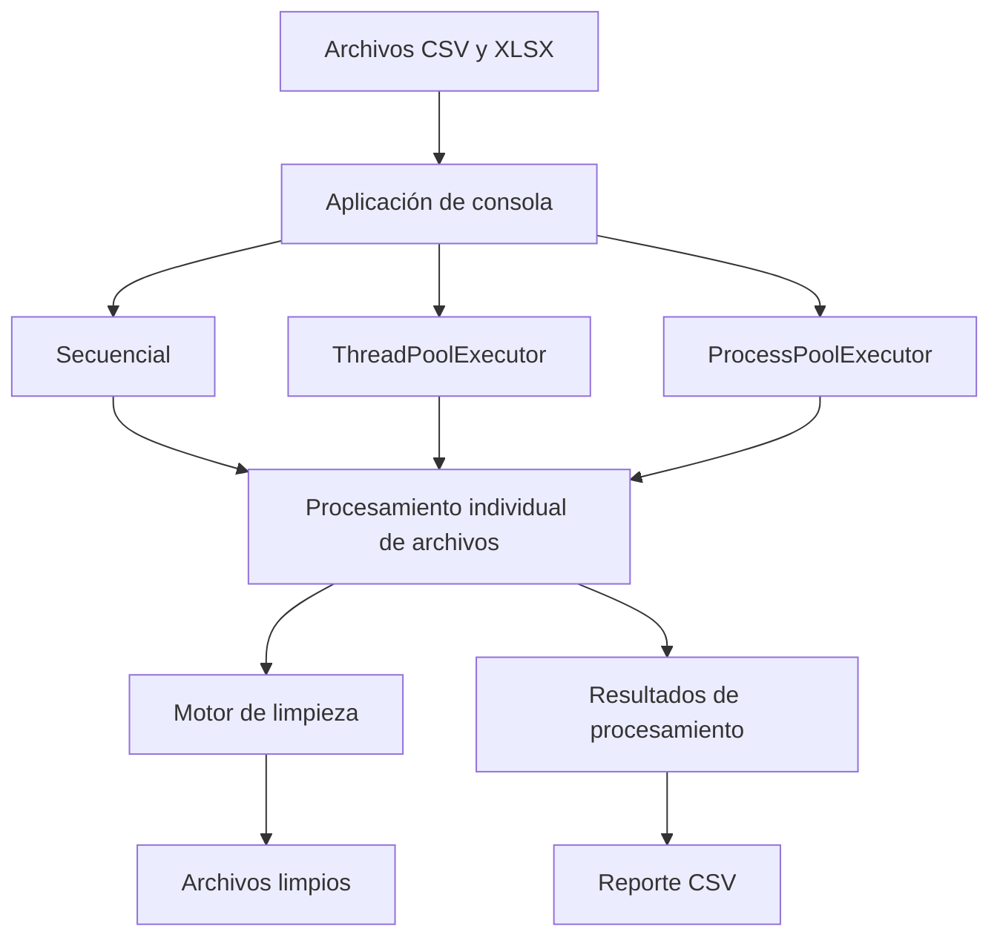
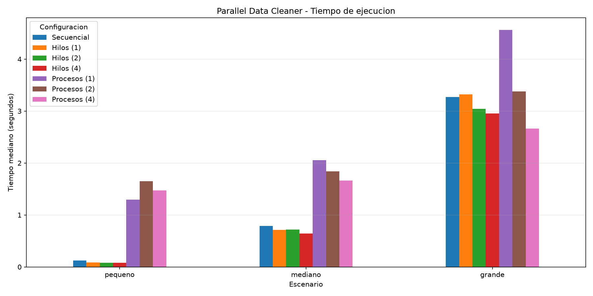
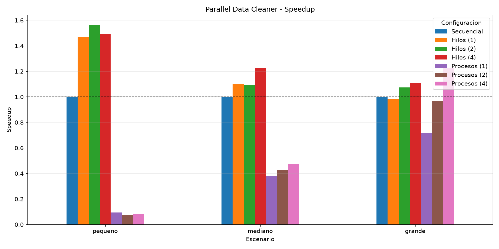
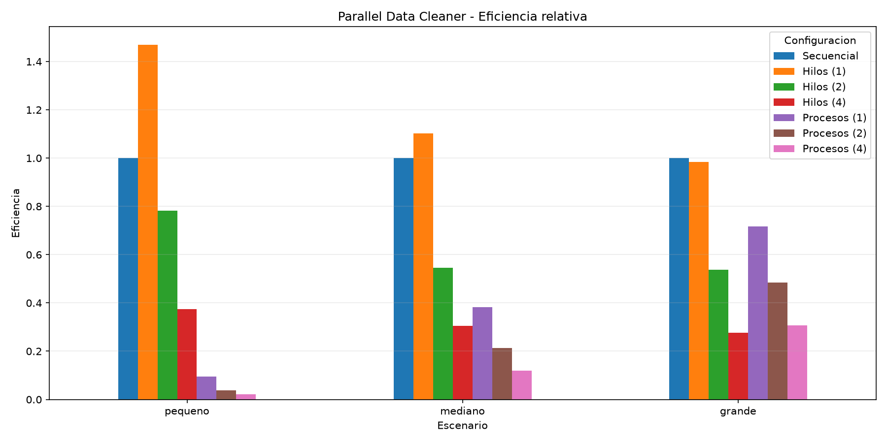

# Parallel Data Cleaner (PDC)


Sistema de limpieza de archivos CSV y XLSX mediante técnicas de programación secuencial, concurrente y paralela en Python.

Proyecto integrador de la asignatura de Programación Paralela de Ingeniería en Computación, Centro Universitario UNE.

## 1. Descripción del proyecto

Parallel Data Cleaner es una aplicación de consola diseñada para automatizar la limpieza de múltiples archivos de datos y evaluar el rendimiento de diferentes estrategias de procesamiento.

El sistema implementa tres modalidades de ejecución:

- Procesamiento secuencial.
- Procesamiento concurrente mediante hilos.
- Procesamiento paralelo mediante procesos.

Las tres modalidades utilizan el mismo motor de limpieza, permitiendo comparar su rendimiento bajo condiciones equivalentes.

## 2. Objetivo

Diseñar, implementar y evaluar un sistema de procesamiento de archivos que permita analizar las ventajas, limitaciones y costos asociados con la programación secuencial, concurrente y paralela.

### Objetivos específicos

- Automatizar la limpieza de archivos CSV y XLSX.
- Implementar una versión secuencial como referencia.
- Implementar concurrencia mediante ThreadPoolExecutor.
- Implementar paralelismo mediante ProcessPoolExecutor.
- Verificar la equivalencia de los resultados.
- Evaluar tiempos de ejecución, speedup y eficiencia relativa.
- Garantizar la reproducibilidad de los experimentos.

## 3. Funcionalidades

- Lectura de archivos CSV y XLSX.
- Eliminación de registros completamente duplicados.
- Normalización de espacios en columnas de texto.
- Normalización de representaciones textuales de valores faltantes.
- Contabilización de valores nulos.
- Exportación de archivos limpios.
- Manejo individual de errores.
- Generación de reportes de procesamiento.
- Generación reproducible de datos sintéticos.
- Evaluación experimental del rendimiento.
- Validación de equivalencia mediante SHA-256 para CSV.
- Generación de gráficas comparativas.

## 4. Tecnologías utilizadas

| Tecnología | Propósito |
|---|---|
| Python 3.12 | Lenguaje principal |
| pandas | Manipulación y limpieza de datos |
| openpyxl | Procesamiento de archivos XLSX |
| concurrent.futures | Concurrencia y paralelismo |
| hashlib | Validación de equivalencia |
| unittest | Pruebas automatizadas |
| matplotlib | Visualización de resultados |
| Git y GitHub | Control de versiones |
| Visual Studio Code | Entorno de desarrollo |

## 5. Arquitectura

El proyecto utiliza una arquitectura modular que separa el motor de limpieza, las estrategias de ejecución, las pruebas y la evaluación experimental.



Cada archivo constituye una unidad independiente de trabajo.

Los trabajadores procesan archivos diferentes y generan resultados independientes. El proceso principal recupera los resultados y genera el reporte consolidado.

Este diseño evita la necesidad de utilizar bloqueos explícitos sobre un estado mutable compartido entre trabajadores durante una ejecución normal.

## 6. Estructura del repositorio

```text
parallel-data-cleaner/
├── benchmarks/
│   ├── generate_data.py
│   ├── run_benchmarks.py
│   ├── validate_results.py
│   └── plot_results.py
├── data/
│   ├── raw/
│   ├── cleaned/
│   └── samples/
├── docs/
├── reports/
│   ├── benchmark_raw.csv
│   ├── benchmark_summary.csv
│   ├── benchmark_comparison.png
│   ├── benchmark_speedup.png
│   ├── benchmark_efficiency.png
│   └── environment.txt
├── src/
│   ├── __init__.py
│   ├── cleaner.py
│   ├── sequential.py
│   ├── threaded.py
│   └── parallel.py
├── tests/
│   ├── test_cleaner.py
│   ├── test_processing.py
│   └── test_edge_cases.py
├── .gitignore
├── main.py
├── README.md
└── requirements.txt
```

## 7. Instalación

### Clonar el repositorio

```powershell
git clone https://github.com/010213reyes/parallel-data-cleaner.git
cd parallel-data-cleaner
```

### Crear un entorno virtual

```powershell
py -3.12 -m venv .venv
```

### Activar el entorno virtual en PowerShell

```powershell
Set-ExecutionPolicy -Scope Process -ExecutionPolicy RemoteSigned
.\.venv\Scripts\Activate.ps1
```

### Instalar las dependencias

```powershell
python -m pip install -r requirements.txt
```

## 8. Ejecución de la aplicación

Colocar los archivos CSV o XLSX que se desean procesar en:

```text
data/raw/
```

Ejecutar:

```powershell
python main.py
```

La aplicación presenta el siguiente menú:

```text
=============================================
       PARALLEL DATA CLEANER
=============================================

Selecciona el modo de procesamiento:

1. Secuencial
2. Hilos
3. Procesos
```

Las modalidades de hilos y procesos utilizan cuatro trabajadores de manera predeterminada.

### Archivos de salida

Los archivos procesados se almacenan en:

```text
data/cleaned/
```

Los reportes se generan en:

```text
reports/reporte_secuencial.csv
reports/reporte_hilos.csv
reports/reporte_procesos.csv
```

El reporte incluye el estado del procesamiento, las estadísticas de limpieza y el tiempo correspondiente a cada archivo procesado correctamente.

Los archivos originales no se modifican. Las ejecuciones posteriores pueden sobrescribir archivos de salida con el mismo nombre.

## 9. Estrategias de procesamiento

### Procesamiento secuencial

Procesa los archivos individualmente, utilizando una sola secuencia de ejecución.

Constituye la referencia para evaluar el rendimiento de las alternativas concurrentes y paralelas.

### Procesamiento concurrente

Utiliza ThreadPoolExecutor para distribuir archivos entre múltiples hilos.

Permite superponer tareas, especialmente durante operaciones de entrada y salida.

Su rendimiento depende de las características de la carga de trabajo, la biblioteca utilizada y las restricciones del intérprete de Python.

### Procesamiento paralelo

Utiliza ProcessPoolExecutor para distribuir archivos entre procesos independientes.

Permite aprovechar múltiples núcleos de procesamiento, aunque introduce costos asociados con la creación y coordinación de procesos.

## 10. Validación y pruebas

Ejecutar:

```powershell
python -m unittest discover -s tests -v
```

Las pruebas automatizadas incluyen:

- Validación del motor de limpieza.
- Equivalencia entre estrategias de procesamiento.
- Directorios sin archivos.
- Archivos CSV con encabezados y sin registros.
- Procesamiento de archivos XLSX.
- Manejo de archivos corruptos.

Resultado obtenido:

```text
Ran 6 tests

OK
```

Las seis pruebas fueron aprobadas.

## 11. Evaluación experimental

La aplicación está diseñada para procesar archivos CSV y XLSX
de origen real o sintético, independientemente de su temática
y estructura de columnas.

Para la evaluación controlada del rendimiento se utilizaron
tres escenarios de datos generados artificialmente mediante
semillas reproducibles, con el propósito de garantizar
condiciones equivalentes entre las estrategias evaluadas.

El uso de estos datos experimentales no restringe el
procesamiento de datasets reales.

| Escenario | Archivos | Filas por archivo | Filas totales |
|---|---:|---:|---:|
| Pequeño | 5 | 1,100 | 5,500 |
| Mediano | 20 | 5,100 | 102,000 |
| Grande | 50 | 10,100 | 505,000 |
| Total | 75 | — | 612,500 |

Las cantidades incluyen los registros duplicados incorporados por el generador.

### Configuraciones experimentales

- Secuencial.
- Hilos con 1, 2 y 4 trabajadores.
- Procesos con 1, 2 y 4 trabajadores.

Se realizaron cinco mediciones por configuración y escenario, además de una ejecución de calentamiento por configuración.

Total:

- 3 escenarios.
- 7 configuraciones por escenario.
- 105 mediciones registradas.
- 21 ejecuciones de calentamiento.
- 18 validaciones de equivalencia.

### Reproducción de los experimentos

Generar los datos sintéticos:

```powershell
python benchmarks/generate_data.py
```

Ejecutar los benchmarks:

```powershell
python benchmarks/run_benchmarks.py
```

Validar los resultados:

```powershell
python benchmarks/validate_results.py
```

Generar las gráficas:

```powershell
python benchmarks/plot_results.py
```

El generador utiliza el directorio data/benchmarks/ y puede reemplazar los archivos CSV generados anteriormente en los escenarios experimentales.

La ejecución de los benchmarks puede sobrescribir los reportes experimentales existentes.

## 12. Métricas de rendimiento

### Tiempo de ejecución

Tiempo requerido para completar el procesamiento de los archivos, incluyendo lectura, limpieza, escritura y gestión de los trabajadores.

### Speedup

Relación entre el tiempo secuencial y el tiempo de la estrategia evaluada.

S = Ts / Tp

Donde:

- Ts: tiempo de ejecución secuencial.
- Tp: tiempo de ejecución de la configuración evaluada.

### Eficiencia relativa

E = S / p

Donde:

- S: speedup.
- p: número de trabajadores.

Esta métrica representa el aprovechamiento relativo de los trabajadores y no una medición directa de la utilización del procesador.

También se registraron la media, mediana, desviación estándar y cantidad de archivos procesados por segundo.

## 13. Resultados experimentales

Tiempos medianos expresados en segundos:

| Configuración | Pequeño | Mediano | Grande |
|---|---:|---:|---:|
| Secuencial | 0.1233 | 0.7868 | 3.2689 |
| Hilos (1) | 0.0839 | 0.7135 | 3.3201 |
| Hilos (2) | 0.0789 | 0.7200 | 3.0447 |
| Hilos (4) | 0.0825 | 0.6430 | 2.9550 |
| Procesos (1) | 1.2961 | 2.0581 | 4.5650 |
| Procesos (2) | 1.6497 | 1.8369 | 3.3797 |
| Procesos (4) | 1.4756 | 1.6607 | 2.6653 |

### Configuraciones con menor tiempo mediano

| Escenario | Configuración | Speedup |
|---|---|---:|
| Pequeño | Hilos (2) | 1.5626 |
| Mediano | Hilos (4) | 1.2237 |
| Grande | Procesos (4) | 1.2265 |

Los resultados muestran que no existe una estrategia universalmente superior para todos los tamaños de entrada evaluados.

El procesamiento mediante procesos presentó una mejora en el escenario grande con cuatro trabajadores, mientras que los hilos obtuvieron los menores tiempos en los escenarios pequeño y mediano.

### Comparación de tiempos



### Speedup



### Eficiencia relativa



Los resultados individuales y consolidados se encuentran en:

- reports/benchmark_raw.csv
- reports/benchmark_summary.csv

## 14. Equivalencia de resultados

Se verificaron los archivos CSV generados por las estrategias concurrentes y paralelas mediante hashes SHA-256, utilizando los archivos producidos por la implementación secuencial como referencia.

| Escenario | Configuraciones aprobadas |
|---|---:|
| Pequeño | 6/6 |
| Mediano | 6/6 |
| Grande | 6/6 |
| Total | 18/18 |

Se realizaron 450 comparaciones de archivos de salida.

Todas las configuraciones evaluadas produjeron archivos CSV idénticos a los obtenidos mediante la implementación secuencial.

## 15. Entorno de desarrollo y validación

Características registradas el 24 de noviembre de 2026:

| Componente | Especificación |
|---|---|
| Procesador | Intel Core i3-1115G4 @ 3.00 GHz |
| Núcleos físicos | 2 |
| Procesadores lógicos | 4 |
| Memoria RAM disponible para el sistema | 7.65 GB |
| Sistema operativo | Windows 11 Home Single Language |
| Python | 3.12.10 |
| pandas | 2.3.3 |
| openpyxl | 3.1.5 |
| matplotlib | 3.11.2 |

El registro completo se encuentra en reports/environment.txt.

La captura del entorno fue realizada después de las mediciones experimentales originales.

## 16. Limitaciones

- - Las mediciones experimentales de rendimiento se realizaron
  con archivos CSV generados de forma controlada. La aplicación
  admite archivos CSV y XLSX reales.
- Los archivos XLSX se procesan considerando únicamente la primera hoja.
- No se conserva el formato visual original de Excel.
- Los valores faltantes no se imputan automáticamente.
- El rendimiento depende del hardware, el almacenamiento y las características de los archivos.
- Los costos de creación de procesos pueden superar los beneficios del paralelismo en cargas pequeñas.
- El sistema no implementa procesamiento distribuido.
- La ejecución simultánea de varias instancias sobre el mismo directorio de salida puede provocar sobrescrituras.
- El orden fijo de los experimentos puede introducir efectos de caché y variabilidad temporal.

## 17. Metodología de desarrollo

El proyecto fue desarrollado mediante ramas independientes de Git.

| Rama | Propósito |
|---|---|
| feature/limpieza-secuencial | Motor de limpieza y procesamiento secuencial |
| feature/concurrencia-paralelismo | Implementación de hilos y procesos |
| feature/benchmarks | Evaluación experimental |
| feature/validacion-final | Pruebas y visualización de resultados |
| docs/entrega-final | Documentación académica y técnica |

La versión funcional de la aplicación se encuentra identificada mediante la etiqueta v1.0.0.


## Validación funcional con archivos de distintas fuentes

Además de la evaluación experimental controlada, se realizó
una prueba funcional utilizando cinco archivos de diferentes
fuentes, estructuras y formatos.

El lote incluyó cuatro archivos CSV y un archivo XLSX.

| Método | Archivos procesados | Errores | Tiempo (s) | Speedup |
|---|---:|---:|---:|---:|
| Secuencial | 5 | 0 | 2.6654 | 1.000 |
| Hilos | 5 | 0 | 1.5313 | 1.741 |
| Procesos | 5 | 0 | 2.4720 | 1.078 |

Las tres estrategias procesaron correctamente todos los
archivos sin necesidad de modificar el código fuente.

En esta prueba, la implementación concurrente mediante hilos
redujo el tiempo de ejecución aproximadamente un 42.55 %
respecto a la implementación secuencial.

Estos resultados corresponden a una demostración funcional
complementaria y no sustituyen las 105 mediciones de la
evaluación experimental controlada.

La aplicación admite datasets de origen real o sintético,
sin depender de una estructura de columnas específica.


## 18. Conclusiones

Parallel Data Cleaner demuestra la aplicación práctica de la programación secuencial, concurrente y paralela en un problema de procesamiento de datos.

La evaluación experimental permitió identificar que la selección de una estrategia depende del tamaño de la carga de trabajo y de los costos asociados con su ejecución.

La equivalencia de los resultados fue comprobada mediante pruebas automatizadas y comparaciones de archivos, garantizando la consistencia de las salidas en los escenarios evaluados.

## 19. Autor

Luis Alberto Reyes Estrada

Ingeniería en Computación

Centro Universitario UNE

Proyecto integrador de Programación Paralela.

## 20. Repositorio

https://github.com/010213reyes/parallel-data-cleaner

Versión de la aplicación: v1.0.0

Estado técnico: implementación y validación completadas.
