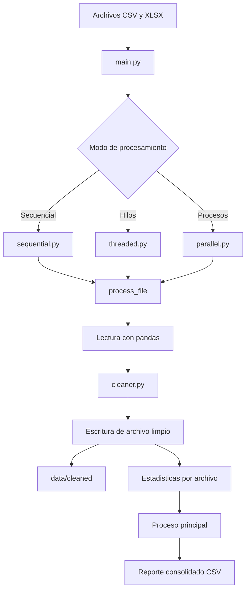
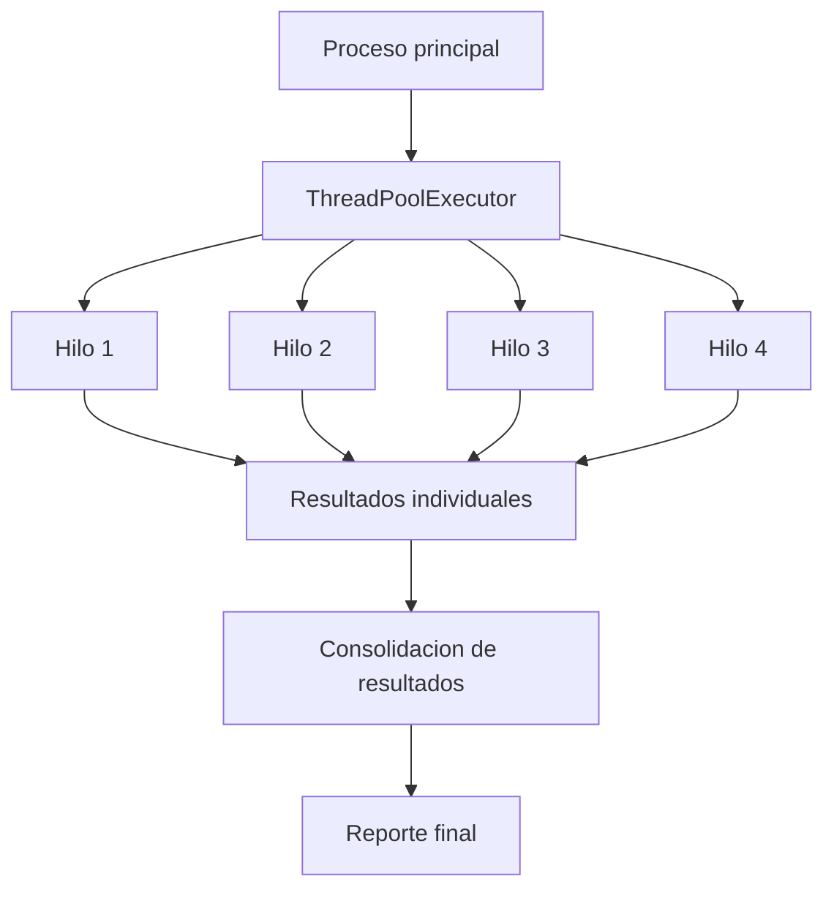
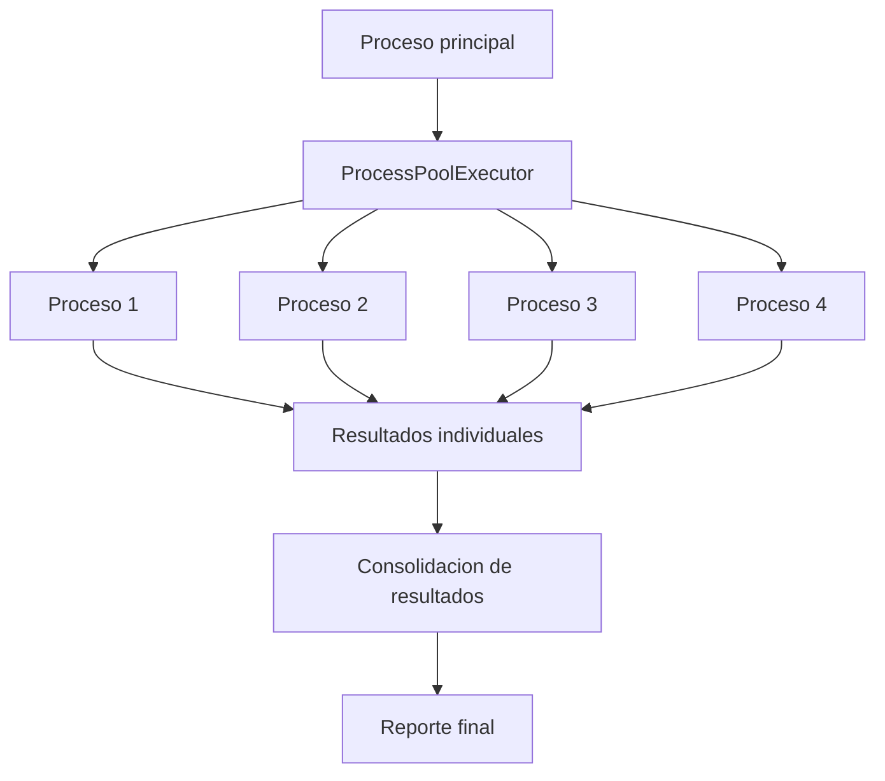
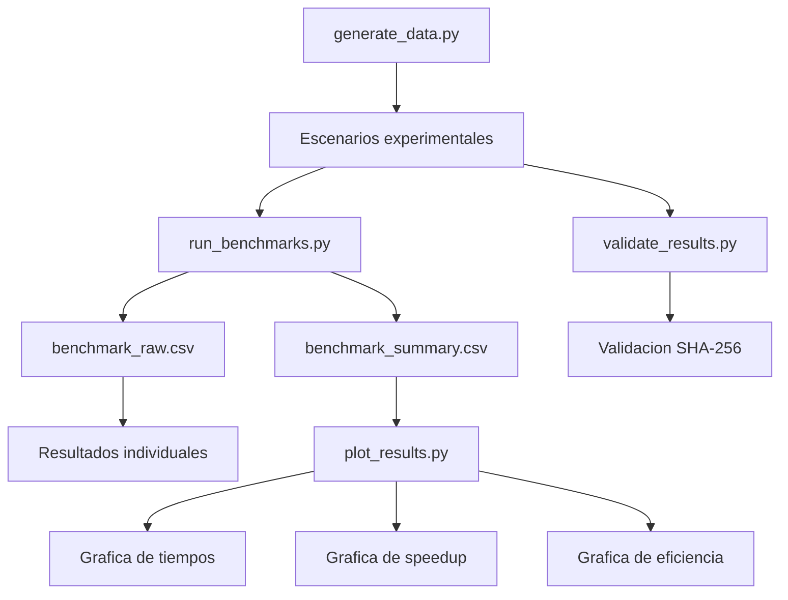

# 02. Arquitectura del sistema

## 1. Diseño arquitectónico

Parallel Data Cleaner utiliza una arquitectura modular
que separa la interfaz de usuario, las estrategias de
procesamiento, el motor de limpieza y la evaluación
experimental.

Esta separación permite modificar o evaluar las estrategias
de ejecución sin alterar las operaciones de limpieza
aplicadas a los archivos.

## 2. Componentes del sistema

| Componente | Responsabilidad |
|---|---|
| main.py | Interfaz de consola y generación de reportes |
| src/cleaner.py | Operaciones de limpieza de datos |
| src/sequential.py | Procesamiento individual y secuencial |
| src/threaded.py | Distribución de tareas mediante hilos |
| src/parallel.py | Distribución de tareas mediante procesos |
| benchmarks/ | Evaluación experimental y validación |
| tests/ | Pruebas automatizadas |
| data/ | Almacenamiento de entradas y salidas |
| reports/ | Resultados y evidencias de ejecución |

## 3. Diagrama general de arquitectura



## 4. Descomposición del problema

El sistema utiliza una descomposición por archivos.

Cada archivo representa una unidad independiente de
trabajo que puede ser asignada a un trabajador.

Una tarea comprende las siguientes operaciones:

1. Leer el archivo.
2. Crear una estructura DataFrame.
3. Aplicar el motor de limpieza.
4. Calcular las estadísticas correspondientes.
5. Exportar el archivo procesado.
6. Devolver el resultado de la ejecución.

Los archivos no se dividen internamente entre trabajadores.

Esta estrategia corresponde a una descomposición de tareas
independientes, donde cada trabajador puede procesar un
archivo completo sin depender de los resultados de otros.

## 5. Procesamiento secuencial

La implementación secuencial constituye la referencia
experimental del proyecto.

Los archivos se procesan individualmente y en orden.

El procesamiento de un archivo debe finalizar antes de
iniciar el siguiente.


### Características

- Una secuencia principal de ejecución.
- Procesamiento consecutivo de archivos.
- Menor complejidad de coordinación.
- Ausencia de costos de creación de trabajadores adicionales.
- Referencia para calcular el speedup.

## 6. Procesamiento concurrente mediante hilos

La implementación concurrente utiliza ThreadPoolExecutor,
perteneciente al módulo concurrent.futures de Python.

El proceso principal identifica los archivos disponibles
y envía las tareas al ejecutor.

Los hilos recuperan las tareas pendientes conforme
se encuentran disponibles.



### Características

- Los hilos pertenecen al mismo proceso.
- Comparten el espacio de memoria del proceso.
- Cada tarea utiliza sus propias estructuras de datos.
- Permiten superponer operaciones de entrada y salida.
- La aplicación utiliza cuatro trabajadores por defecto.
- Los experimentos evalúan uno, dos y cuatro trabajadores.

En CPython 3.12, el Global Interpreter Lock limita la
ejecución simultánea de código Python entre hilos.

Sin embargo, las operaciones de entrada y salida y algunas
operaciones de bibliotecas nativas pueden permitir
beneficios de concurrencia.

Por esta razón, el rendimiento depende de las características
de la carga de trabajo.

## 7. Procesamiento paralelo mediante procesos

La implementación paralela utiliza ProcessPoolExecutor.

Cada trabajador se ejecuta en un proceso independiente,
con su propio espacio de memoria e intérprete de Python.

El proceso principal distribuye las tareas y recupera
los resultados al finalizar su ejecución.



### Características

- Procesos con espacios de memoria independientes.
- Posibilidad de ejecución simultánea en distintos núcleos.
- Aislamiento de las estructuras de datos.
- Costos adicionales de creación y coordinación.
- Transferencia de argumentos y resultados entre procesos.
- Cuatro trabajadores por defecto.

La aplicación protege su punto de entrada mediante:

```python
if __name__ == "__main__":
    main()
```

Esta condición es importante para evitar la ejecución
recursiva del programa principal durante la creación
de procesos en Windows.

## 8. Distribución dinámica de tareas

La distribución de archivos se realiza mediante los
ejecutores de concurrent.futures.

Cada archivo se envía como una tarea independiente.

Los trabajadores disponibles recuperan nuevas tareas
conforme finalizan las anteriores.

No existe una asignación fija de archivos a trabajadores.

Esto permite procesar archivos de diferentes tamaños
sin requerir una partición manual de la carga.

## 9. Coordinación y sincronización

Las implementaciones concurrente y paralela utilizan
objetos Future para representar las tareas enviadas
a los ejecutores.

La función as_completed permite recuperar los resultados
conforme las tareas finalizan.

El proceso principal es responsable de:

- Enviar las tareas.
- Recuperar los resultados.
- Identificar errores individuales.
- Ordenar los resultados por nombre de archivo.
- Generar el reporte consolidado.

La finalización de los ejecutores garantiza que las tareas
enviadas sean atendidas antes de continuar con la
consolidación final.

El orden de finalización de los archivos puede variar,
pero el reporte se organiza de manera determinista
por nombre de archivo.

## 10. Justificación de la ausencia de locks explícitos

El sistema no utiliza bloqueos explícitos mediante
threading.Lock o multiprocessing.Lock.

Esta decisión se fundamenta en la independencia de las
tareas.

Cada trabajador:

- Lee un archivo diferente.
- Utiliza su propio DataFrame.
- Aplica las operaciones de limpieza localmente.
- Escribe un archivo de salida independiente.
- Devuelve sus estadísticas al proceso principal.

Los trabajadores no modifican directamente un contador
global ni escriben simultáneamente sobre el mismo
reporte consolidado.

La coordinación interna de las tareas se delega a los
ejecutores de concurrent.futures.

Por lo tanto, no se requiere introducir mecanismos
adicionales de exclusión mutua sobre los datos
procesados durante una ejecución normal.

## 11. Riesgos de concurrencia y mecanismos de prevención

| Riesgo | Prevención o consideración |
|---|---|
| Condiciones de carrera | Independencia de archivos y estructuras de datos |
| Escritura simultánea del reporte | El reporte se genera desde el proceso principal |
| Interbloqueos | No existen locks explícitos ni dependencias circulares entre tareas |
| Pérdida de resultados | Recuperación individual mediante Future |
| Archivos corruptos | Manejo individual de excepciones |
| Sobrescritura entre instancias | Evitar ejecutar varias instancias sobre el mismo directorio |
| Saturación de memoria | Limitar la cantidad de trabajadores según el hardware |
| Contención de almacenamiento | Considerar los costos de lectura y escritura simultáneas |

Estas medidas reducen los riesgos asociados con la
ejecución concurrente, aunque no eliminan todas las
posibles fallas externas o limitaciones del sistema.

## 12. Flujo de datos

El flujo general de procesamiento comprende:

Entrada de archivos
    -> Identificación de archivos compatibles
    -> Distribución de tareas
    -> Lectura de datos
    -> Limpieza
    -> Escritura de resultados
    -> Recuperación de estadísticas
    -> Generación del reporte

Los archivos originales permanecen en data/raw/.

Los archivos procesados se almacenan en data/cleaned/.

Los reportes de ejecución se almacenan en reports/.

## 13. Arquitectura de evaluación experimental

La evaluación experimental se mantiene separada
de la aplicación principal.



Esta separación permite evaluar las estrategias de
procesamiento sin interferir con los archivos de uso
cotidiano de la aplicación.

Los datos generados para los experimentos no constituyen
un requisito para utilizar el sistema con archivos reales.

## 14. Escalabilidad y limitaciones arquitectónicas

La arquitectura permite incrementar la cantidad de
archivos y modificar el número de trabajadores desde
las funciones de procesamiento.

Sin embargo, el rendimiento no aumenta necesariamente
de manera proporcional al número de trabajadores.

Los principales factores que limitan la escalabilidad son:

- Cantidad de núcleos físicos.
- Cantidad de procesadores lógicos.
- Memoria RAM.
- Velocidad del almacenamiento.
- Tamaño individual de los archivos.
- Costos de creación de procesos.
- Características de las operaciones de limpieza.

El sistema carga cada archivo completo en memoria.

Por lo tanto, no está diseñado para procesar archivos
individuales que excedan la memoria disponible.

## 15. Conclusión arquitectónica

La arquitectura de Parallel Data Cleaner permite comparar
tres estrategias de ejecución utilizando un motor de
limpieza común.

La independencia de las tareas facilita la distribución
de archivos y reduce la necesidad de sincronización
explícita.

El diseño modular permite mantener separadas las
responsabilidades de procesamiento, coordinación,
validación y evaluación experimental.
