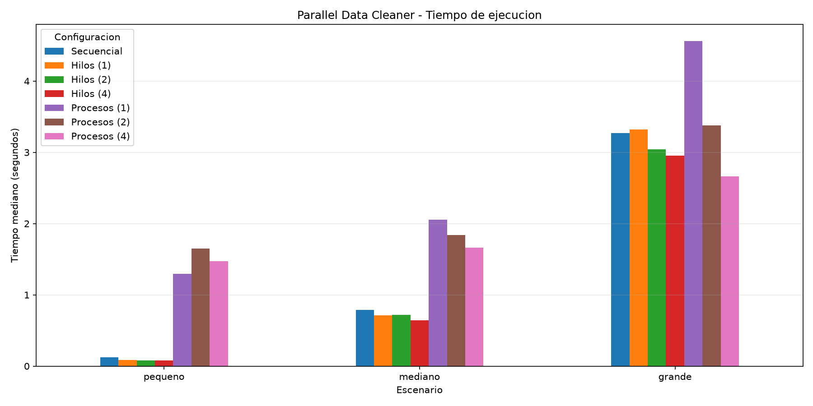
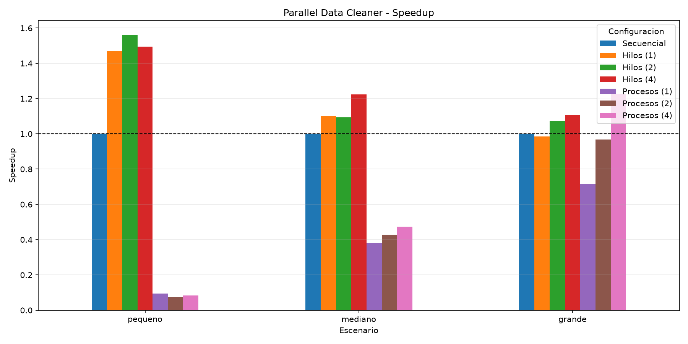
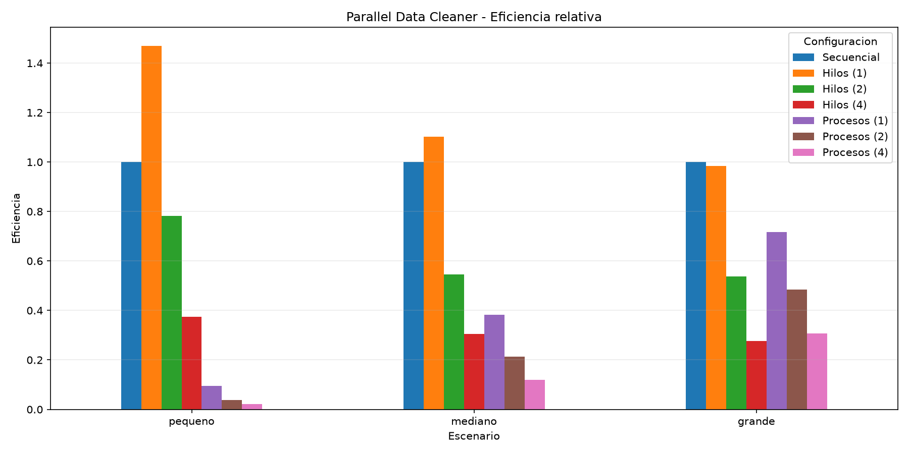

# 05. Resultados y análisis experimental

## 1. Objetivo de la evaluación

Evaluar el rendimiento de Parallel Data Cleaner mediante
la comparación de las estrategias secuencial, concurrente
y paralela bajo diferentes tamaños de carga de trabajo
y cantidades de trabajadores.

La evaluación busca identificar las ventajas, limitaciones
y costos asociados con cada estrategia, manteniendo
constantes las operaciones de limpieza.

## 2. Metodología experimental

Se establecieron tres escenarios de procesamiento
mediante archivos CSV generados de forma reproducible.

La generación controlada permite utilizar las mismas
entradas para todas las configuraciones evaluadas.

Estos archivos se utilizaron exclusivamente como
instrumentos de evaluación experimental.

La aplicación también admite archivos CSV y XLSX
proporcionados por el usuario, como se comprobó
mediante la validación funcional complementaria.

### 2.1 Escenarios experimentales

| Escenario | Archivos | Filas por archivo | Filas totales |
|---|---:|---:|---:|
| Pequeño | 5 | 1100 | 5500 |
| Mediano | 20 | 5100 | 102000 |
| Grande | 50 | 10100 | 505000 |
| Total | 75 | - | 612500 |

Las cantidades incluyen los registros duplicados
incorporados durante la generación de los archivos.

### 2.2 Configuraciones evaluadas

| Estrategia | Trabajadores |
|---|---|
| Secuencial | 1 |
| Hilos | 1, 2 y 4 |
| Procesos | 1, 2 y 4 |

La versión secuencial constituye la referencia
para calcular las métricas de rendimiento.

Las configuraciones con un trabajador mediante
ejecutores no son equivalentes a la implementación
secuencial, debido a los mecanismos adicionales
de administración de tareas.

### 2.3 Repeticiones experimentales

Se realizaron cinco mediciones por configuración
y escenario.

Adicionalmente, se realizó una ejecución de
calentamiento por configuración y escenario.

El diseño experimental comprende:

- Tres escenarios.
- Siete configuraciones por escenario.
- Cinco mediciones por configuración.
- 105 mediciones registradas.
- 21 ejecuciones de calentamiento.
- 126 ejecuciones experimentales en total.

Las ejecuciones de calentamiento no forman parte
de las 105 mediciones utilizadas para calcular
las estadísticas finales.

## 3. Entorno de ejecución

Las características del entorno fueron registradas
el 24 de noviembre de 2026.

| Componente | Especificación |
|---|---|
| Procesador | Intel Core i3-1115G4 @ 3.00 GHz |
| Núcleos físicos | 2 |
| Procesadores lógicos | 4 |
| Memoria RAM reconocida | 7.65 GB |
| Sistema operativo | Windows 11 Home Single Language |
| Versión del sistema | 10.0.26300 |
| Python | 3.12.10 |
| pandas | 2.3.3 |
| openpyxl | 3.1.5 |
| matplotlib | 3.11.2 |

El registro completo se encuentra disponible en:

reports/environment.txt

Las mediciones experimentales originales se realizaron
el 19 de noviembre de 2026.

La captura del entorno se realizó posteriormente,
por lo que no constituye un registro simultáneo
de las versiones de software durante los benchmarks.

Matplotlib se utiliza para generar las visualizaciones
y no forma parte del motor de limpieza.

## 4. Métricas de evaluación

### 4.1 Tiempo de ejecución

El tiempo de ejecución representa la duración total
del procesamiento de un lote de archivos.

La medición incluye:

- Lectura de archivos.
- Operaciones de limpieza.
- Escritura de archivos procesados.
- Distribución y recuperación de tareas.
- Administración de trabajadores cuando corresponde.

La medición se realiza mediante time.perf_counter.

### 4.2 Promedio

El promedio representa la media aritmética de las
cinco mediciones registradas por configuración.

Promedio = suma de tiempos / número de mediciones

### 4.3 Mediana

La mediana representa el valor central de las
mediciones ordenadas.

Se seleccionó como métrica principal debido a su
menor sensibilidad ante mediciones excepcionalmente
altas o bajas.

### 4.4 Desviación estándar

La desviación estándar permite describir la
dispersión de los tiempos registrados.

Una desviación menor indica una menor variabilidad
absoluta entre las mediciones.

Para comparar la estabilidad entre configuraciones
con tiempos diferentes también debe considerarse
la magnitud relativa de dicha dispersión.

### 4.5 Speedup

El speedup representa la relación entre el tiempo
mediano secuencial y el tiempo mediano de la
configuración evaluada.

S = Ts / Tp

Donde:

- Ts: tiempo mediano secuencial.
- Tp: tiempo mediano de la configuración evaluada.

Interpretación:

- S > 1: mejora respecto a la referencia.
- S = 1: rendimiento equivalente.
- S < 1: rendimiento inferior a la referencia.

### 4.6 Eficiencia relativa

La eficiencia relativa se calcula mediante:

E = S / p

Donde:

- S: speedup.
- p: número de trabajadores.

Esta métrica describe el speedup obtenido por
trabajador respecto a la referencia secuencial.

No representa directamente la utilización del
procesador ni el porcentaje de actividad de los
núcleos físicos.

### 4.7 Rendimiento de procesamiento

El rendimiento se expresa mediante la cantidad
de archivos procesados por segundo.

R = N / Tp

Donde:

- N: cantidad de archivos del escenario.
- Tp: tiempo mediano de procesamiento.

Esta métrica permite comparar configuraciones
dentro de un mismo escenario.

La comparación entre escenarios debe considerar
que los archivos tienen diferentes cantidades
de registros.

## 5. Resultados del escenario pequeño

El escenario pequeño contiene cinco archivos
con un total de 5500 registros.

### 5.1 Tiempos y dispersión

| Método | Trabajadores | Mediana (s) | Promedio (s) | Desviación (s) |
|---|---:|---:|---:|---:|
| Secuencial | 1 | 0.1233 | 0.1174 | 0.0108 |
| Hilos | 1 | 0.0839 | 0.0838 | 0.0027 |
| Hilos | 2 | 0.0789 | 0.0831 | 0.0113 |
| Hilos | 4 | 0.0825 | 0.0837 | 0.0026 |
| Procesos | 1 | 1.2961 | 1.3805 | 0.2271 |
| Procesos | 2 | 1.6497 | 1.6216 | 0.1052 |
| Procesos | 4 | 1.4756 | 1.5618 | 0.1446 |

### 5.2 Métricas de rendimiento

| Método | Trabajadores | Speedup | Eficiencia | Archivos/s |
|---|---:|---:|---:|---:|
| Secuencial | 1 | 1.0000 | 1.0000 | 40.55 |
| Hilos | 1 | 1.4703 | 1.4703 | 59.62 |
| Hilos | 2 | 1.5626 | 0.7813 | 63.37 |
| Hilos | 4 | 1.4955 | 0.3739 | 60.64 |
| Procesos | 1 | 0.0951 | 0.0951 | 3.86 |
| Procesos | 2 | 0.0747 | 0.0374 | 3.03 |
| Procesos | 4 | 0.0836 | 0.0209 | 3.39 |

### 5.3 Interpretación

La configuración con dos hilos obtuvo el menor
tiempo mediano, con 0.0789 segundos.

El speedup obtenido fue de 1.5626, equivalente
a una reducción aproximada del 36.0 % respecto
al procesamiento secuencial.

El incremento de dos a cuatro hilos no produjo
una mejora adicional en la mediana.

Las configuraciones basadas en procesos
presentaron tiempos considerablemente superiores
a la referencia secuencial.

Este comportamiento es consistente con una carga
de trabajo insuficiente para compensar los costos
de inicialización y administración de procesos.

Sin embargo, dichos costos no fueron medidos
de manera aislada.

La configuración con cuatro hilos presentó una
menor dispersión absoluta que la configuración
con dos hilos.

Por lo tanto, dos hilos obtuvieron la mejor
mediana, mientras que cuatro hilos presentaron
una mayor estabilidad absoluta en las mediciones.

## 6. Resultados del escenario mediano

El escenario mediano contiene veinte archivos
con un total de 102000 registros.

### 6.1 Tiempos y dispersión

| Método | Trabajadores | Mediana (s) | Promedio (s) | Desviación (s) |
|---|---:|---:|---:|---:|
| Secuencial | 1 | 0.7868 | 0.9061 | 0.2304 |
| Hilos | 1 | 0.7135 | 0.7218 | 0.0527 |
| Hilos | 2 | 0.7200 | 0.7624 | 0.1033 |
| Hilos | 4 | 0.6430 | 0.6660 | 0.0446 |
| Procesos | 1 | 2.0581 | 2.0828 | 0.2719 |
| Procesos | 2 | 1.8369 | 1.9937 | 0.2556 |
| Procesos | 4 | 1.6607 | 1.7372 | 0.1906 |

### 6.2 Métricas de rendimiento

| Método | Trabajadores | Speedup | Eficiencia | Archivos/s |
|---|---:|---:|---:|---:|
| Secuencial | 1 | 1.0000 | 1.0000 | 25.42 |
| Hilos | 1 | 1.1027 | 1.1027 | 28.03 |
| Hilos | 2 | 1.0928 | 0.5464 | 27.78 |
| Hilos | 4 | 1.2237 | 0.3059 | 31.11 |
| Procesos | 1 | 0.3823 | 0.3823 | 9.72 |
| Procesos | 2 | 0.4283 | 0.2142 | 10.89 |
| Procesos | 4 | 0.4738 | 0.1184 | 12.04 |

### 6.3 Interpretación

La configuración con cuatro hilos obtuvo el
menor tiempo mediano, con 0.6430 segundos.

El speedup fue de 1.2237, equivalente a una
reducción aproximada del 18.3 % respecto a la
implementación secuencial.

Las configuraciones basadas en procesos
mostraron una reducción progresiva del tiempo
mediano al incrementar el número de trabajadores.

Sin embargo, ninguna configuración basada
en procesos logró superar el rendimiento
de la implementación secuencial.

La configuración con cuatro hilos también
presentó la menor desviación estándar absoluta
del escenario, con aproximadamente 0.0446 segundos.

Estos resultados respaldan la selección de
cuatro hilos para esta carga de trabajo
experimental.

## 7. Resultados del escenario grande

El escenario grande contiene cincuenta archivos
con un total de 505000 registros.

### 7.1 Tiempos y dispersión

| Método | Trabajadores | Mediana (s) | Promedio (s) | Desviación (s) |
|---|---:|---:|---:|---:|
| Secuencial | 1 | 3.2689 | 3.4439 | 0.3974 |
| Hilos | 1 | 3.3201 | 3.4545 | 0.3483 |
| Hilos | 2 | 3.0447 | 3.0671 | 0.2322 |
| Hilos | 4 | 2.9550 | 3.0427 | 0.2317 |
| Procesos | 1 | 4.5650 | 4.5058 | 0.3490 |
| Procesos | 2 | 3.3797 | 3.4130 | 0.1426 |
| Procesos | 4 | 2.6653 | 2.6434 | 0.0517 |

### 7.2 Métricas de rendimiento

| Método | Trabajadores | Speedup | Eficiencia | Archivos/s |
|---|---:|---:|---:|---:|
| Secuencial | 1 | 1.0000 | 1.0000 | 15.30 |
| Hilos | 1 | 0.9846 | 0.9846 | 15.06 |
| Hilos | 2 | 1.0736 | 0.5368 | 16.42 |
| Hilos | 4 | 1.1062 | 0.2766 | 16.92 |
| Procesos | 1 | 0.7161 | 0.7161 | 10.95 |
| Procesos | 2 | 0.9672 | 0.4836 | 14.79 |
| Procesos | 4 | 1.2265 | 0.3066 | 18.76 |

### 7.3 Interpretación

La configuración con cuatro procesos obtuvo
el menor tiempo mediano, con 2.6653 segundos.

El speedup obtenido fue de 1.2265, equivalente
a una reducción aproximada del 18.5 % respecto
al procesamiento secuencial.

Esta configuración también superó el rendimiento
de cuatro hilos.

La desviación estándar de cuatro procesos fue
de aproximadamente 0.0517 segundos, la menor
dispersión absoluta registrada en este escenario.

El comportamiento observado es consistente
con una mayor capacidad de amortizar los
costos de creación y administración de procesos
cuando aumenta la carga de trabajo.

Los resultados no permiten determinar de
manera aislada cuánto tiempo corresponde
al procesamiento de CPU, a la entrada y salida
o a la administración de trabajadores.

## 8. Comparación general de tiempos

| Configuración | Pequeño (s) | Mediano (s) | Grande (s) |
|---|---:|---:|---:|
| Secuencial | 0.1233 | 0.7868 | 3.2689 |
| Hilos (1) | 0.0839 | 0.7135 | 3.3201 |
| Hilos (2) | 0.0789 | 0.7200 | 3.0447 |
| Hilos (4) | 0.0825 | 0.6430 | 2.9550 |
| Procesos (1) | 1.2961 | 2.0581 | 4.5650 |
| Procesos (2) | 1.6497 | 1.8369 | 3.3797 |
| Procesos (4) | 1.4756 | 1.6607 | 2.6653 |



Los resultados muestran que ninguna estrategia
obtuvo el menor tiempo mediano en todos los
escenarios evaluados.

## 9. Análisis del speedup



| Escenario | Mejor configuración | Speedup | Reducción de tiempo |
|---|---|---:|---:|
| Pequeño | Hilos (2) | 1.5626 | 36.0 % |
| Mediano | Hilos (4) | 1.2237 | 18.3 % |
| Grande | Procesos (4) | 1.2265 | 18.5 % |

La configuración con dos hilos en el escenario
pequeño obtuvo el mayor speedup observado.

Las configuraciones con procesos presentaron
speedup inferior a uno en los escenarios
pequeño y mediano.

Estos resultados negativos de rendimiento
constituyen evidencia experimental válida.

No se eliminaron configuraciones por presentar
tiempos superiores a la referencia secuencial.

## 10. Análisis de eficiencia relativa



| Escenario | Mejor configuración por tiempo | Eficiencia relativa |
|---|---|---:|
| Pequeño | Hilos (2) | 78.13 % |
| Mediano | Hilos (4) | 30.59 % |
| Grande | Procesos (4) | 30.66 % |

El incremento de trabajadores no produjo
una aceleración proporcional.

La eficiencia relativa disminuye en diversas
configuraciones conforme aumenta la cantidad
de trabajadores.

Este comportamiento puede estar relacionado
con los costos de coordinación, las operaciones
de entrada y salida, las restricciones del
intérprete y los recursos físicos disponibles.

### 10.1 Eficiencia superior al 100 %

Algunas configuraciones con un hilo presentan
una eficiencia relativa superior a uno.

Por ejemplo, en el escenario pequeño:

S = 1.4703

E = 1.4703 / 1 = 1.4703

Este resultado no significa que el procesador
haya utilizado más del 100 % de su capacidad.

La métrica se calcula respecto a una
implementación secuencial diferente del
ejecutor con un trabajador.

Las diferencias pueden estar relacionadas con
la variabilidad experimental, el estado de
las cachés, el almacenamiento y otros factores
del entorno de ejecución.

No se realizaron experimentos adicionales
para identificar la causa específica.

## 11. Análisis de dispersión

La desviación estándar permite complementar
el análisis basado en los tiempos medianos.

| Escenario | Desviación secuencial (s) | Mejor configuración | Desviación (s) |
|---|---:|---|---:|
| Pequeño | 0.0108 | Hilos (2) | 0.0113 |
| Mediano | 0.2304 | Hilos (4) | 0.0446 |
| Grande | 0.3974 | Procesos (4) | 0.0517 |

En el escenario pequeño, la configuración
con menor mediana presentó una dispersión
absoluta ligeramente superior a la referencia.

En los escenarios mediano y grande, las
configuraciones con menor tiempo mediano
también presentaron una menor dispersión
absoluta respecto a la versión secuencial.

La configuración de cuatro procesos en el
escenario grande destacó por combinar el
menor tiempo mediano con una desviación
estándar reducida.

Debido a que se realizaron cinco mediciones
por configuración, los resultados deben
interpretarse como evidencia descriptiva.

No se realizaron pruebas de significancia
estadística ni se calcularon intervalos
de confianza.

## 12. Rendimiento de procesamiento

| Escenario | Secuencial (archivos/s) | Mejor configuración (archivos/s) |
|---|---:|---:|
| Pequeño | 40.55 | 63.37 |
| Mediano | 25.42 | 31.11 |
| Grande | 15.30 | 18.76 |

La cantidad de archivos procesados por segundo
aumentó en las mejores configuraciones de
cada escenario respecto a su referencia.

No debe interpretarse la reducción de
archivos por segundo entre escenarios como
una disminución directa del rendimiento,
debido a que los archivos contienen
diferentes cantidades de registros.

## 13. Validación funcional complementaria

Se realizó una demostración adicional mediante
cinco archivos de distintas fuentes y formatos.

El lote incluyó cuatro archivos CSV y un
archivo XLSX, con un total de 103262 registros.

| Método | Tiempo (s) | Speedup | Archivos procesados | Errores |
|---|---:|---:|---:|---:|
| Secuencial | 2.6654 | 1.0000 | 5 | 0 |
| Hilos | 1.5313 | 1.7406 | 5 | 0 |
| Procesos | 2.4720 | 1.0782 | 5 | 0 |

La modalidad concurrente mediante hilos
obtuvo el menor tiempo registrado.

La reducción del tiempo respecto a la
versión secuencial fue aproximadamente
del 42.55 %.

Las tres estrategias procesaron correctamente
todos los archivos del lote.

Los resultados demuestran que la aplicación
no depende del generador de datos utilizado
durante los benchmarks.

Esta demostración corresponde a una ejecución
por modalidad y no sustituye la evaluación
experimental de 105 mediciones.

## 14. Discusión de resultados

### 14.1 Influencia del tamaño de la carga

Las estrategias basadas en procesos presentaron
un rendimiento inferior a la referencia
secuencial en cargas pequeñas y medianas.

En el escenario grande, cuatro procesos
consiguieron superar la referencia.

Este comportamiento sugiere que la cantidad
de trabajo asignada a los procesos influye
en la capacidad de compensar sus costos
de administración.

### 14.2 Influencia de los trabajadores

Incrementar el número de trabajadores
no garantiza una mejora proporcional.

En el escenario pequeño, dos hilos obtuvieron
una mediana inferior a cuatro hilos.

En el escenario grande, incrementar la
cantidad de procesos permitió reducir
progresivamente el tiempo mediano.

### 14.3 Influencia del hardware

El equipo utilizado dispone de dos núcleos
físicos y cuatro procesadores lógicos.

La ejecución con cuatro trabajadores no
implica disponer de cuatro núcleos físicos
independientes.

Los recursos disponibles pueden limitar
la escalabilidad del procesamiento.

### 14.4 Naturaleza de la carga de trabajo

Parallel Data Cleaner combina operaciones
de entrada y salida con operaciones de
transformación de datos.

Por lo tanto, no constituye una carga
exclusivamente intensiva en CPU ni
exclusivamente intensiva en entrada y salida.

Esta combinación puede favorecer diferentes
estrategias dependiendo de las características
de los archivos.

## 15. Limitaciones experimentales

- Se realizaron cinco mediciones por configuración.
- Los experimentos se ejecutaron en un solo equipo.
- No se evaluaron configuraciones superiores a cuatro trabajadores.
- Los benchmarks controlados utilizaron archivos CSV.
- No se midió individualmente el consumo de memoria.
- No se registró la utilización individual de los núcleos.
- No se aislaron los costos de creación de trabajadores.
- No se realizaron pruebas de significancia estadística.
- El orden fijo de ejecución puede introducir efectos de caché.
- No se controlaron de manera exhaustiva los procesos externos.
- El entorno de software se documentó después de los benchmarks.
- La demostración con archivos externos no incluye repeticiones.

Estas limitaciones no invalidan las mediciones
obtenidas, pero delimitan el alcance de las
conclusiones.

## 16. Reproducibilidad

Los resultados originales se encuentran en:

- reports/benchmark_raw.csv
- reports/benchmark_summary.csv
- reports/environment.txt

Las gráficas se encuentran en:

- reports/benchmark_comparison.png
- reports/benchmark_speedup.png
- reports/benchmark_efficiency.png

Los experimentos pueden reproducirse mediante:

```powershell
python benchmarks/generate_data.py
python benchmarks/run_benchmarks.py
python benchmarks/validate_results.py
python benchmarks/plot_results.py
```

Los tiempos obtenidos en nuevas ejecuciones
pueden variar debido a las condiciones
del hardware y del sistema operativo.

La reproducción de los experimentos puede
sobrescribir los reportes existentes.

## 17. Conclusión experimental

Los resultados muestran que la selección
de una estrategia de procesamiento depende
del tamaño y las características de la
carga de trabajo.

La concurrencia mediante hilos obtuvo
los menores tiempos medianos en los
escenarios pequeño y mediano.

El paralelismo mediante cuatro procesos
obtuvo el menor tiempo mediano en el
escenario grande.

La demostración funcional con archivos
de distintas fuentes confirmó la capacidad
de procesamiento de las tres modalidades.

La validación de equivalencia realizada
sobre los escenarios experimentales permite
respaldar la consistencia de los resultados
producidos por las diferentes estrategias.

Parallel Data Cleaner proporciona una
implementación funcional y reproducible
para estudiar las ventajas y limitaciones
de la programación concurrente y paralela.
